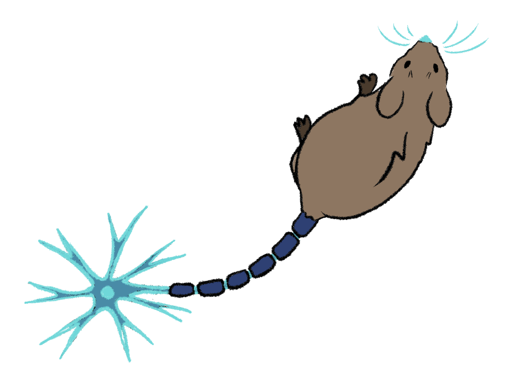

## About

Hi, I'm a Cognitive Sciences major at UC Irvine. Admittedly newish to coding and haven't done much with it yet, but I'm getting there.

I draw, write, read, and play music in my free time. I also have an abnormal fascination and affection for animals, psychological matters, and Russian literature. Anything that involves analysis and the interweaving of heart and brain, I tend to enjoy.

  

<em>(art by yours truly)</em>

<!--
**marissa-wang/marissa-wang** is a ✨ _special_ ✨ repository because its `README.md` (this file) appears on your GitHub profile.

Here are some ideas to get you started:

- 🔭 I’m currently working on ...
- 🌱 I’m currently learning ...
- 👯 I’m looking to collaborate on ...
- 🤔 I’m looking for help with ...
- 💬 Ask me about ...
- 📫 How to reach me: ...
- 😄 Pronouns: ...
- ⚡ Fun fact: ...
-->
